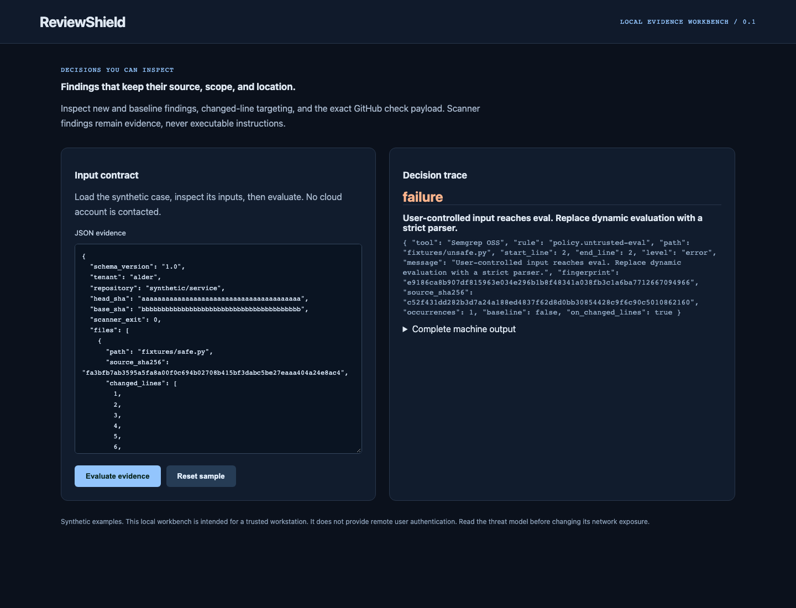
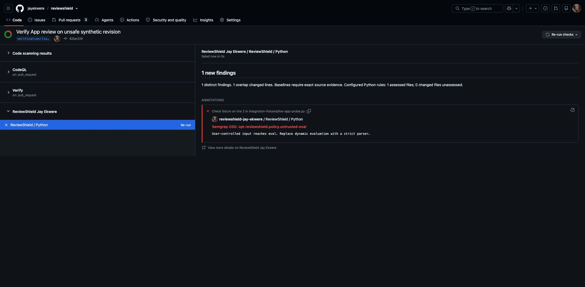

# ReviewShield

[](https://github.com/jayekwere/reviewshield/actions/workflows/verify.yml)
[](LICENSE)

**Secure review evidence from scanner output to GitHub checks.**

A TypeScript review engine, durable GitHub App webhook queue, restricted installation-token publisher, and Python Semgrep runner. Findings retain tool, rule, source hash, location, severity and baseline identity. The local workbench inspects the exact check payload without contacting GitHub.



## Run locally

Requires Node 24.13+ or Node 26, and a trusted workstation. The initial setup downloads locked dependencies. Afterwards the core synthetic CLI and UI demos work offline. No cloud account or paid service is required.

```sh
git clone https://github.com/jayekwere/reviewshield.git
cd reviewshield
npm ci --ignore-scripts
npm run build
npm run demo
npm start
```

Open [http://127.0.0.1:8080](http://127.0.0.1:8080). For a container demo, run `docker compose up --build`. Compose publishes only to loopback, uses UID 10001, drops capabilities, denies privilege escalation and makes the root filesystem read-only. No input is persisted by the web evaluator. The default network posture is local-only. Do not expose a demo listener as a production service.

## What it enforces

- Accepts Semgrep and CodeQL SARIF 2.1.0 with explicit successful invocation evidence. Scanner failure, missing source context, invalid paths or malformed regions fail closed.
- Exact duplicates retain an occurrence count and merge to the strongest severity. Different tools, rules, messages or locations remain distinct.
- Baselines bind tenant, repository, fingerprint, complete source-file hash, severity, expiry and review reason. Foreign, expired, stale, duplicate and unused entries are errors. Line moves or changed source require review.
- New findings fail the check even outside changed lines. Only overlapping findings produce file annotations, batched at GitHub's 50-annotation limit.
- Webhooks authenticate original bytes with HMAC-SHA256. The queue deduplicates signed payload hashes rather than an unsigned delivery header. Automatic scans use an immutable base/head comparison and SHA-pinned directory trees; selected paths must be regular files with the exact expected blob. Publication additionally rechecks the live PR head/base and numeric repository identity.

## Inputs, integrations and evidence

The committed `samples/semgrep.sarif` was produced by a real local Semgrep run against `fixtures/unsafe.py`. The source is intentionally unsafe and is never imported or executed. The bundled rule detects direct `eval(input(...))` syntax only; it is not a general taint analysis or a complete Python security policy. Indirect parameter flows and other vulnerability classes require additional reviewed rules or a separate scanner. `fixtures/safe.py` supplies a negative source. The package release installed for the recorded run is 1.183.0; its emitted SARIF reports semantic version 1.166.0. Both values are preserved rather than rewritten.

```sh
python3 -m venv .scanner
.scanner/bin/python -m pip install --require-hashes -r requirements-scanner.lock
python3 scanner/scan.py fixtures artifacts/semgrep.sarif --semgrep .scanner/bin/semgrep
node --import tsx scripts/verify-scan.ts artifacts/semgrep.sarif
```

The separate CodeQL workflow runs real hosted analysis and retains SARIF artifacts. The recorded JavaScript/TypeScript and Python runs each reported zero findings; both actual artifacts were imported successfully by the review engine. See [the import evidence](docs/codeql-import-verification.json). This analysis is report-only for this repository. A CodeQL producer must supply successful invocation evidence and a complete source manifest before its SARIF is eligible for the review gate. The automatic scanner container receives no App credentials. Host-run scanner tools inherit their launch environment and must be started without account credentials.

For a real App, create a trusted `BINDINGS_FILE` JSON array with `tenant`, `installation_id`, `repository_id` and `repository`; set a private `QUEUE_PATH`, a 32-character-or-longer `WEBHOOK_SECRET`, `APP_ID` and `APP_KEY_FILE`. Run `node dist/src/app.js webhook` and, in a separate process with access to Docker, `node dist/src/app.js worker`. The coordinator claims queued events, fetches bounded native PR files and Git blobs, verifies Git object hashes, derives changed lines, runs the isolated scanner and independently rechecks the live PR before publishing. Use `node dist/src/app.js work JOB_SHA256` for one queued event. The advanced `publish JOB_SHA256 TRUSTED_ARTIFACT.json` command accepts only an operator-trusted artifact. The App asks for checks write, contents read and pull requests read on one repository. It does not request contents write or execute PR source. See [GitHub webhook validation](https://docs.github.com/en/webhooks/using-webhooks/validating-webhook-deliveries) and [check API documentation](https://docs.github.com/en/rest/checks/runs).

Actual native PR/blob reads and the isolated scanner were exercised on unsafe and safe revisions of a dedicated draft PR, including stale-head rejection. See [the native read evidence](docs/live-read-verification.json). A separate [live App acceptance record](docs/github-app-verification.json) now verifies actual signed delivery, App-token publication, native annotation readback, duplicate-delivery rejection and stale-head rejection.

Generated machine output is committed in [samples/output.json](samples/output.json). The [architecture](docs/architecture.md), [threat model](docs/threatmodel.md), [verification record](docs/verification.md), and [distinct scope](docs/portfolio-scope.md) explain the implementation and its boundaries. Strict runtime models are authoritative; published [schemas](schemas) document the contracts. External Terraform and SARIF metadata can carry provider extensions; security-relevant fields receive explicit validation.

## Verify

```sh
npm run verify
npx playwright install chromium
npm run test:browser
docker build -t reviewshield:local .
node scripts/container-smoke.mjs reviewshield:local
```

CI runs lint, strict TypeScript checks, unit/adversarial tests, measured coverage, builds, the local demo, browser interactions, dependency audit and a hardened container smoke check. Node source coverage is reported transparently; it is not a claim of complete path coverage. Every Action uses a verified full commit SHA, checkout credentials are disabled, and the verification workflow has only contents read permission. Browser installation and container builds need network during setup. Artifact retention is 14 days. Repository maintainers control policy and workflow changes.

## Limits and trust

A real repository-only GitHub App installation, signed webhook deliveries and narrowed installation-token check publication were exercised on [acceptance PR 3](https://github.com/jayekwere/reviewshield/pull/3). Native readback verified the unsafe line-2 failure, safe-revision success, replay rejection and no check on a superseded head. [Exact evidence](docs/github-app-verification.json) separates this local live acceptance from unit transports and hosted CI. Persistent production hosting and required-check branch protection remain operator responsibilities.

The built-in coordinator binds source hashes, changed lines, base/head SHAs and scanner evidence to native PR blobs. It reviews changed non-deleted Python files using the configured rules. Other changed files are explicitly unassessed and force a neutral result when no findings fail the review; a PR without Python files fails coordination without a clean check. It never checks out or executes the repository. CodeQL SARIF remains a separate trusted-artifact workflow. Do not accept a scan envelope directly from an untrusted PR author. A source hash is a binding assertion from that trusted worker, not proof that a submitted report is authentic. The workbench's tenant is a sample label, not a login.

Automatic review accepts at most 299 changed files, below GitHub's capped comparison-file response. Missing or truncated comparison/tree evidence fails without a clean check. Directory reads follow only selected paths, with a 4 MiB response bound, 1,000-read budget and five-minute API-read deadline. Fork objects must be readable through the scoped base-repository token; inaccessible objects fail closed. The [hardening record](docs/security-audit.json) documents the audit findings, fixes and regression scope.

Publication may leave a partial check or duplicate check after an ambiguous network failure; no exactly-once external publication claim is made. A durable body-hash queue does not prevent a compromised webhook secret or trusted installation operator from issuing new valid events. Fingerprints are conservative and location-sensitive. Cross-scanner semantic merging, automatic suppression, PR code execution and automatic fixes are excluded. SARIF result suppression flags are not honored as reviewed exceptions.

 

See [SECURITY.md](SECURITY.md) and [CONTRIBUTING.md](CONTRIBUTING.md). MIT covers this repository's original code; dependencies retain their respective licenses.

## Credential-free scan worker

A separate [static scan worker](docs/scan-worker.md) now runs real Semgrep with native file-coverage checks in a restricted container. It rejects PR-controlled ignores, symlinks, parser errors and skipped Python files. App credentials stay in the trusted Node queue worker, with a separate credential-free scanner container. The queue worker implements bounded PR coordination with a declared Python rule scope. Registration, repository-only installation, signed native deliveries and App-owned checks are now verified in the live acceptance record. Persistent hosting, branch-protection configuration and operational recovery remain operator responsibilities.

The temporary verification webhook was disabled after acceptance, and the test PR was closed without merge. The App remains installed on this repository only. Future local runs need a new reachable HTTPS receiver URL and explicit webhook activation. Follow the [local App setup guide](docs/github-app-setup.md) for private files, exact permissions and receiver/worker commands.



[Safe revision check](docs/app-check-safe.jpg) and [installation scope](docs/app-installation.jpg).

Native App acceptance after immutable source hardening is recorded in [immutable source verification](docs/immutable-source-verification.json). The synthetic unsafe revision failed with a precise annotation and the safe revision passed. This acceptance used a trusted local receipt, separately from the historical signed webhook test.

---

**AI assistance:** AI tools helped with code or documentation.
