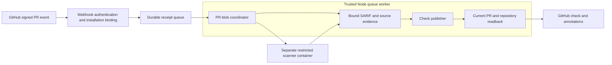

# Architecture

ReviewShield separates offline evaluation, signed event intake, credential-free scanning and privileged publication. The default Node web image serves only the local evaluator. It has no App token or publisher route.

| Component | Responsibility |
| --- | --- |
| `src/main.ts` and `src/io.ts` | Offline CLI and stateless local evaluator with bounded HTTP input |
| `src/github.ts` | Original-byte webhook signatures, installation binding, restricted token request and check publication |
| `src/app.ts` | Signed receiver, durable queue, automatic polling/claiming, token acquisition, coordination and publication; current PR and numeric repository checks |
| `src/review.ts` | Finding fidelity, strongest duplicate severity, exact-source baselines and annotation batches |
| `src/coordinator.ts` | Native PR enumeration, Git blob verification, diff evidence, private source transfer and isolated scanner execution |
| `scanner/worker.py` and `Dockerfile.scanner` | Real Python static scans, clean input copies and exhaustive native file-coverage checks |
| `scanner/scan.py` | Legacy local Semgrep adapter and canonical report-location validation |

The webhook command consumes `BINDINGS_FILE`, `WEBHOOK_SECRET` and `QUEUE_PATH`, defaulting the listener to 127.0.0.1:8081. Queue identity is the signed body hash. The separate queue worker or advanced publish command loads `APP_KEY_FILE`, requests a token narrowed to one repository, checks the queued artifact against the live PR, and submits structured checks. Privileged requests reject redirects. External publication can be partial or duplicate after an ambiguous network failure; queue completion does not provide distributed exactly-once delivery.

The receiver is a separate process. Coordination and check publication share the trusted Node queue-worker process and its token; they are not isolated from each other. The static scan container has no App credentials. The coordinator invocation enforces no network, a read-only root and bounded source manifest on standard input, dropped capabilities, and memory/CPU/PID limits. The worker rejects symlinks, copies only bounded Python files into a clean temporary tree, ignores PR-controlled configuration and requires native coverage of every declared file without scanner errors. Output byte checks occur after process capture; container memory and deadline limits are separate controls. The image alone does not enforce every runtime flag.

The coordinator reads an immutable three-dot comparison of captured base/head SHAs, checks the comparison's base and terminal head, and separately records its merge base. It verifies selected path/blob membership by following SHA-pinned, nontruncated directory trees from the head commit. Only regular file modes are accepted; Git symlinks and submodules cannot be materialized as ordinary Python source. The complete changed-file list must match the captured PR count and contain fewer than 300 files, avoiding GitHub's comparison-file cap. Directory reads follow selected paths rather than downloading the whole repository tree. Each API response is bounded to 4 MiB; 1,000 reads and a five-minute API-read deadline bound traversal. See [GitHub comparison contracts](https://docs.github.com/en/rest/commits/commits#compare-two-commits) and [tree contracts](https://docs.github.com/en/rest/git/trees#get-a-tree).

Native Git blob SHA-1 and byte counts, SHA-256 source evidence and complete diff hunks are checked before transferring bounded Python files over standard input. No host source mount or App credentials enter the container. Native expected/scanned paths and hashes must exactly match those verified files. Mixed-language PRs record unassessed files and cannot receive a whole-PR success from Python-only rules. Installation and repository numeric IDs survive in queued receipts and must still match configured bindings at publication. Legacy receipts without those IDs are rejected. Crashed processing jobs require operator investigation and are not automatically retried. Failed publication is recorded as uncertain once publication begins; a failure does not prove no remote check was written. The worker emits scan evidence rather than a complete publication request. The evaluator's tenant field is a sample label, not authentication. There is no Python HTTP identity service here.

The local evaluator accepts origin-form HTTP request targets. Target parsing is inside the request error boundary, so malformed network-path/absolute targets receive a bounded error without stopping the process. Ordinary routes and query routing retain their existing behavior.

The configured Python rule scope is explicit. Off-diff findings still block; annotations target changed lines. Exact-source, severity and expiry requirements prevent a baseline from silently suppressing a changed finding. SARIF suppression flags do not become reviewed exceptions. CodeQL remains a separate CI SARIF producer.

Real App registration, repository-only installation, signed event delivery and installation-token check publication are verified in [native acceptance evidence](github-app-verification.json), including independent check/annotation readback, replay rejection and stale-head rejection. The restricted Semgrep worker and hosted CI are separately verified on synthetic inputs. See [scan worker setup](scan-worker.md) and the [source-backed threat model](threatmodel.md) for exact resources, assumptions and limits.

Native acceptance used the single-job work command on genuinely signed queued events. It does not establish persistent worker uptime or production hosting. The temporary receiver webhook was disabled after testing; the App registration and local private credentials were retained.
