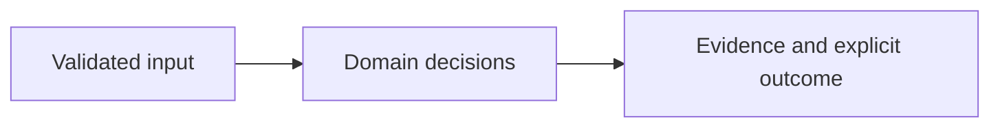

# Architecture

Signed webhook --> installation binding --> durable body-hash queue --> trusted operator scanner artifact --> SARIF review --> live PR/repository readback --> GitHub check

| Component/source | Responsibility |
| --- | --- |
| `src/app.ts:20` | Durable receipts and manual trusted-worker publication coordination |
| `src/github.ts:16` | Raw-byte HMAC verification |
| `src/app.ts:49` | Receipt and current PR revision binding |
| `src/review.ts:153` | Finding fidelity, source-bound baseline, annotation batches |
| `scanner/scan.py:9` | Pinned local Semgrep invocation without source execution |

## Effective resources

| Deployment or consumer | Configuration and location | Recipients or authority | Enforcing control |
| --- | --- | --- | --- |
| Webhook listener | BINDINGS_FILE plus WEBHOOK_SECRET; PORT or 8081; QUEUE_PATH or artifacts/jobs.db | GitHub payload sender and configured installations | HMAC on original bytes, numeric repository/base installation binding, 1 MiB limit, durable body-hash uniqueness |
| Trusted worker | Operator-selected isolated checkout, local rules and SARIF artifact | Trusted operator only; worker scheduler and sandbox are not implemented | Scanner has no App credentials; immutable source/changed-line manifest is an operator obligation |
| Publisher | APP_ID/APP_KEY_FILE; fixed api.github.com; repository-scoped installation token | GitHub receives a signed JWT; only bound repository receives a check | Checks write, contents read, PR read; live PR head/base and numeric repository readback |
| Local workbench | HOST or 127.0.0.1; PORT or 8080 | Local clients, no accounts | Stateless local inspection; no token or publisher route |

## Trust and decisions

Webhook authentication binds a signed payload to a configured installation and repository. Queue identity hashes the body, not the unsigned delivery header. A separately trusted worker must derive all scan inputs from that queued immutable revision. Its manifest remains an assertion from that trusted worker. runJob then binds the artifact to the receipt and current PR head/base before publish checks numeric repository identity. SARIF messages and PR body text never become code or instructions. Source-bound baselines include severity and cannot be reused after source or location changes.

Core domain decisions are separated from HTTP, CLI and external integration adapters. Runtime models reject unsupported contracts instead of interpreting arbitrary instructions. The UI renders supplied strings with textContent. Container startup uses UID 10001 and loopback publication through Compose. Setup downloads dependencies and optional tools once; core synthetic evaluation does not require a network.

## Unresolved integration scope

Real App installation and webhook/token/check publication are unverified. Scanner-worker isolation and artifact authentication require operator infrastructure. External publication can leave partial or duplicate checks on ambiguous failure. CodeQL CI is report-only; its artifact needs successful invocation and source-context evidence before review-gate use.

See the README for exact setup, sample outputs, decision semantics and limits. The threat model distinguishes hypotheses from source-established controls.
